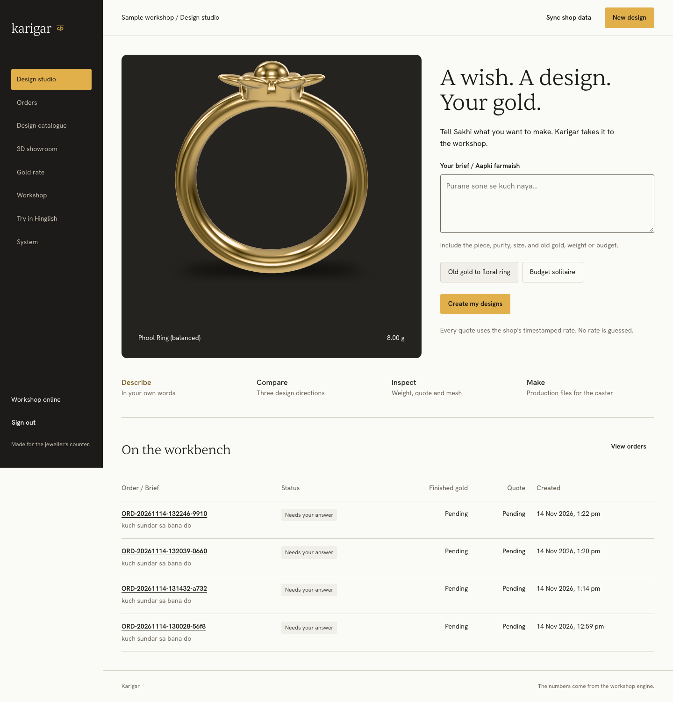

# Karigar

**The design obeys the gold.** An AI jewellery workbench for the Indian jeweller’s counter: describe a piece in English or Hinglish, bring old gold or a budget, and get parametric designs with measured metal weight, a traceable quote and production files.



The language model helps understand the brief. Python builds the geometry, measures metal after stone-seat cuts, solves the weight, checks the mesh and computes the quote. Every model path has an offline fallback.

## Try the workbench

Python **3.13** is required for the pinned Blender module. Tested here on macOS arm64 with `bpy 5.3.0`; Linux/WSL use the same requirements. Blender desktop is optional.

```bash
python3.13 -m venv .venv
.venv/bin/python -m pip install -r requirements.txt
.venv/bin/python scripts/preview_console.py
```

Open **http://127.0.0.1:8080/console/** and use **`local-demo-owner`**. This preview binds only to loopback, uses isolated data in `/tmp/karigar-console-preview`, seeds a clearly labelled sample gold rate and renders a real floral-ring order and the catalogue. The first collection build takes a few minutes. Its public demo tokens must never be used for a public deployment.

The console includes a design studio, searchable orders, three-variant comparison, rotatable GLBs, quote sources, mesh checks, production downloads, edits/version history, catalogue, gold rates, calibration, streamed Hinglish chat and worker status. The viewer and fonts are vendored locally for offline use.

## Run your workshop

```bash
cp .env.example .env
# Set three distinct secrets: API key, worker token, owner token.
# No LLM key is needed for the deterministic fallback.
.venv/bin/python run.py rates refresh
.venv/bin/python run.py serve
```

In another terminal, set `KARIGAR_SERVICE_URL=http://127.0.0.1:8080` in `.env` and run:

```bash
.venv/bin/python run.py worker
```

Open `/console/` with the owner token. Use **Sync shop data** to read the worker’s rates/calibration and **Build collection** for catalogue renders. A production rate must be set within the last 24 hours; missing, stale or invalid rates block an order. For an offline demo, use `run.py rates set` with values you explicitly identify as sample data.

For Render, deploy [`render.yaml`](render.yaml), configure the three distinct secrets, and run the worker on your laptop. The thin service needs only Python’s standard library; **do not install the Blender requirements on Render**. The worker polls over HTTPS and uploads files, so no inbound tunnel is needed. Free-instance files and jobs are ephemeral; durable deployment needs persistent storage. No paid plan has been purchased or deployed by this change.

Connect two Nonilion characters through **Import → Other**, at `/sakhi/v1` and `/karigar/v1`. Follow [the import and live acceptance guide](docs/nonilion-setup.md), with persona files in [`nonilion/`](nonilion/). Nonilion currently forwards full history but no sender identity; chat rate updates therefore fail closed. Images are sent as links. Long-running jobs stream progress and can be retrieved on the next message.

## CLI examples

After configuring a fresh rate:

```bash
.venv/bin/python run.py order "Purani 8.4g 22K chain exchange karni hai, uske badle 22K ladies ring chahiye, size 12, chhota floral design" --quality draft
.venv/bin/python run.py order "₹60,000 all-in for an 18K solitaire with a lab-grown diamond, size 14" --quality draft
.venv/bin/python run.py order "purani 22K chain 6.2g se 22K ruby lotus pendant banao" --quality draft
.venv/bin/python run.py order "22K ring, size 14, under 1.2 g, with a 1 ct diamond" --quality draft
.venv/bin/python run.py order "kuch sundar sa bana do"
.venv/bin/python run.py edit <order_id> "Middle one, but make the flower slightly bigger" --quality draft
.venv/bin/python run.py calibrate --workshop my-shop --designed 10 --actual 9.7
```

Orders write `out/ORD-…/v1…vN/`: `casting.stl`, `model.glb`, `render_hero.png`, `job_card.json`, `job_card.md` and `quote.json`. Edits add `edit.json`. SQLite retains every version. Draft/preview/final control render quality; CPU rendering works without a GPU.

## What the gold means

For 18.4 g of old 22K gold, using the configured 2% exchange deduction and 3% workshop loss:

1. Fine gold: `18.4 × 0.916 × 0.98 = 16.5173 g`.
2. Expected finished 22K weight: `16.5173 ÷ 0.916 = 18.032 g`.
3. Modelled casting weight: `18.032 ÷ 0.97 = 18.5897 g`.
4. The solver changes cross-section while preserving fit, measuring real mesh volume × configured alloy density. Acceptance is within the tighter of 0.1 g and 2%; coins have a tighter weight gate.

**Solver accuracy is not finished-casting accuracy.** Before enough workshop records exist, results show the configured **±4% assumed tolerance**. Calibration learns finishing loss and tolerance from actual casts. There are no physical casting validation pieces yet.

The [mesh-versus-formula proof](docs/weight-proof.md) measures five reference shapes, all within 0.30%. The engine’s flat band has a rounded superellipse cross-section, so its reference uses Pappus’s theorem rather than incorrectly treating it as a rectangular annulus.

## Designs and checks

19 original catalogue families cover rings, pendants, chains, coins, bangles, earrings and nose pins. Earrings are weighed as a pair; bought findings are identified separately. STL scale includes the configured 1% casting shrinkage allowance; GLB stays at design scale.

Mesh checks report pass/warn/fail and location. Thickness rules and sampling assumptions live in `data/dfm_rules.json`; alloy density and tolerance live in `data/casting.json`. Thin designs get one relaxed retry or a refusal with alternatives. These are automated manufacturability checks, not a substitute for a caster’s process approval.

Quote arithmetic is deterministic. The configured policy includes making, stones, hallmarking, split GST and old-gold credit; every line names its source and flags shop assumptions. Review the shop’s tax/process policy before production use. Gold-rate fetching is a separate job; no network fetch or guessed market rate is hidden in an order.

## Verify

```bash
bash scripts/test.sh
.venv/bin/python scripts/weight_proof.py
.venv/bin/python sim/run.py --users 1000 --seed 20261114
```

The final full suite passed **1,119 tests** on the finished tree (15 minutes 25 seconds), including the console and security regressions. See [the completion and evidence ledger](docs/COMPLETION.md) for the latest counts, scope and outstanding live gates. The [1,000-user simulation](docs/user-sim-report.md) covers deterministic intake, authorization and queue/idempotency; it does not claim laptop capacity for 1,000 simultaneous renders.

The [silent backup walkthrough](out/karigar-backup.mp4) is generated locally; see [demo-script.md](docs/demo-script.md) to recreate it.

## Code map

| Area | Responsibility |
|---|---|
| `karigar/core/` | Solver, gold arithmetic, calibration, version store, orchestration and optional LLM gateway |
| `karigar/packs/jewellery/` | Brief, catalogue families, geometry, mesh checks, quote and exports |
| `karigar/service/` | Standard-library HTTP service, durable SQLite queue, replies, worker and owner APIs |
| `console/` | Responsive workbench, local fonts and model-viewer |
| `probe/` | Isolated Nonilion compatibility probe with bounded/redacted logging |
| `sim/`, `tests/` | Seeded counter/queue simulation and automated regression coverage |

Start with [implementation gates](docs/implementation.md), [decisions](docs/decisions.md), [code flow](docs/flow.md), and the [testing guide](docs/testing.md). Hardware and other craft packs remain future scope.
